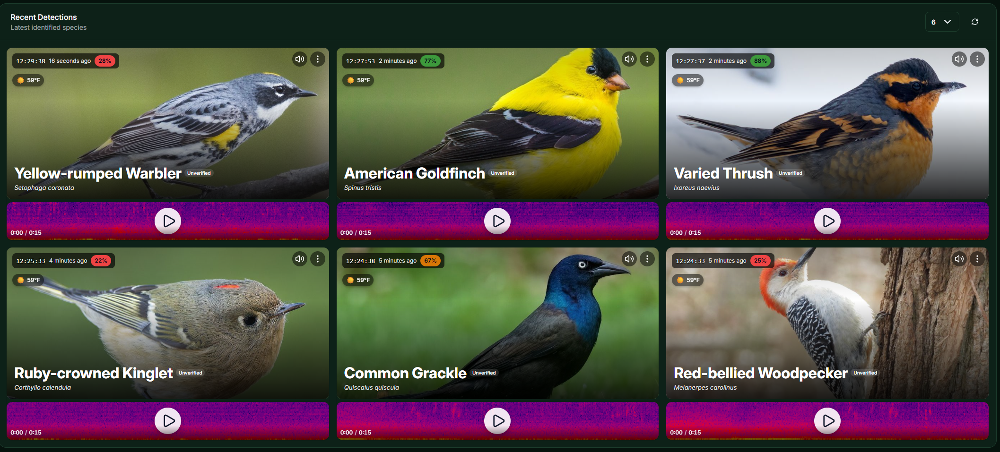
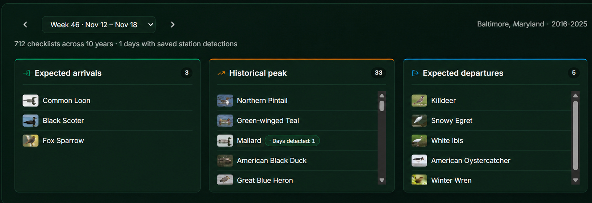
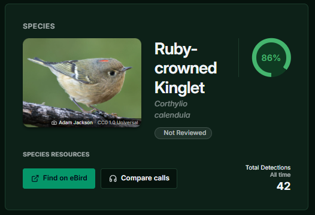
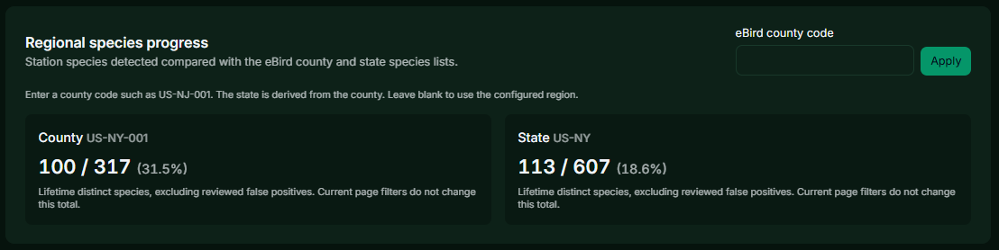

# BirdNET-Go+

A custom fork of BirdNET-Go with additional tools for exploring local bird and wildlife detections.

<p align="center">
  
</p>

- Six photographic detection cards, a wider dashboard, and a dark green theme.
- Weekly bird calendar comparing local eBird history with microphone detections.
- Regional species checklist tracking lifetime detections against county and state eBird species lists.
- Recent eBird observations and BirdCast migration context.
- Native Frigate integration with live cameras, snapshot cards in Recent Detections,
  and camera observations in Search Detections alongside audio results.
- eBird and Cornell Compare Calls links in Detection Details.
- Separate Windows development launcher for testing.

## A closer look

**Bird calendar** — Compare expected arrivals, migration peaks, and departures with birds detected by your microphone.



**Detection details** — Review species confidence and open eBird profiles or Cornell's call comparisons.

<p align="center">
  
</p>

The calendar uses a private local eBird import and refreshes automatically when its watcher is running.

**Regional species checklist** — Track lifetime species progress against county and state eBird lists, with an optional county override.



## Repository layout

- [Tool configuration](.config/README.md): development server, linting, mocks, and changelog settings.
- `frontend/`: Svelte web interface.
- `internal/` and `cmd/`: Go backend and command-line code.
- [deployment/](deployment/README.md): Docker, Podman, and release-package instructions.
- `scripts/`: Installers, development launchers, and maintenance tools.
- [doc/](doc/README.md): Guides, feature documentation, and screenshots.
- `data/samples/`: Example audio recordings.

## Install

Build this fork from source on apt-based Linux or macOS with Homebrew installed. Install Git and [Task](https://taskfile.dev/docs/installation), then run:

```bash
git clone --branch main https://github.com/jumboman32/birdnet-go-plus.git
cd birdnet-go-plus
task setup-dev
```

If setup installed Go, reload your shell profile (`source ~/.profile`) before building:

```bash
task
./bin/birdnet-go serve
```

Open <http://localhost:8080/ui/dashboard> and configure your location, audio source, and acoustic model in Settings. Keep the working directory for configuration, recordings, and database files.

For a packaged Windows development build, extract the complete package into a separate directory and run `Start-Development.cmd`. Node.js is required. Open <http://localhost:8081/ui/dashboard>; see the [Windows launcher guide](scripts/development/README.md) for details.

The calendar's local eBird dataset is a separate import; see the [eBird profile guide](tools/ebird-profile/README.md). Standard upstream Docker images do not include this fork's changes.

## Frigate cameras

Enable Frigate under **Settings > Integrations > Frigate**, enter the API URL
reachable from the BirdNET-Go+ server, select cameras, and save. **Live Cameras**
appears in the sidebar only while the integration is enabled. For a local Frigate
instance, its trusted internal API commonly uses `http://127.0.0.1:5000`; the scheme
must match the port. Keep that unauthenticated API restricted to a trusted network.

Bird observations appear in dashboard Recent Detections with their actual snapshots,
cropped to the same image frame as audio cards. Search Detections defaults to **All
sources** and also offers **Audio** and **Frigate** filters. Object detection and
species classification retain separate confidence scores; an unidentified bird stays
unidentified. Camera observations use the v2 database and do not count as audio
detections. See the [Frigate guide](doc/FRIGATE.md) for authentication, polling,
snapshot retention, and configuration details.

Built on the work of the BirdNET-Go contributors.

Google Perch v2 ONNX conversion by [Justin Chuby](https://huggingface.co/justinchuby/BirdNET-onnx). BattyBirdNET bat classifier models by [R.D. Zinck](https://github.com/rdz-oss/BattyBirdNET-Analyzer). BirdNET label translations by Patrick Levin for the BirdNET-Pi project by Patrick McGuire.
