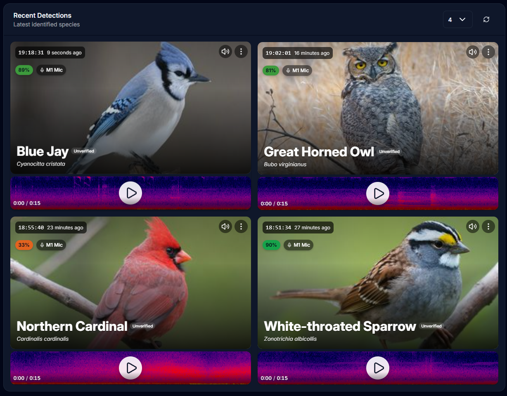
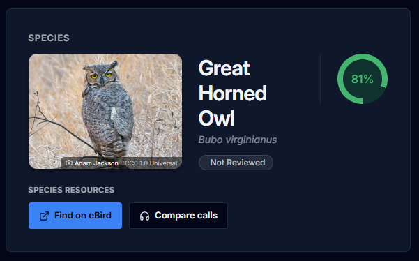

# BirdNET-Go+
A custom fork of BirdNET-Go with additional tools for exploring local bird and wildlife detections.
- eBird and Cornell Compare Calls links in Detection Details.
- Separate Windows development launcher for testing.
- UI Changes

  
  

Numeric rarity scores require historical checklist data; an eBird API key alone is insufficient. BirdCast does not affect the score.

Built on the work of the BirdNET-Go contributors.

Google Perch v2 ONNX conversion by [Justin Chuby](https://huggingface.co/justinchuby/BirdNET-onnx). BattyBirdNET bat classifier models by [R.D. Zinck](https://github.com/rdz-oss/BattyBirdNET-Analyzer). BirdNET label translations by Patrick Levin for the BirdNET-Pi project by Patrick McGuire.
