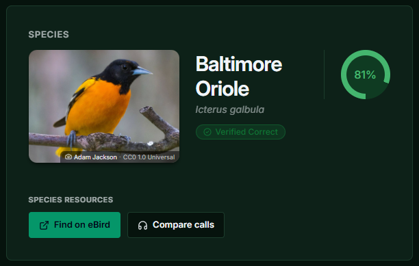
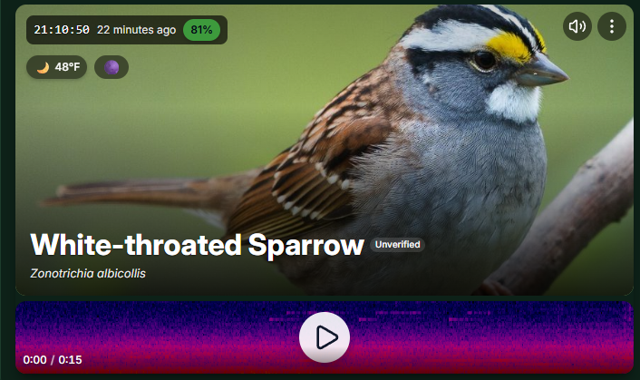

# BirdNET-Go+

A custom fork of BirdNET-Go with additional tools for exploring local bird and wildlife detections.

- Local Rarity Scoring System
- Higher Quality Images
- eBird and Cornell Compare Calls links in Detection Details.

  

- Bird Calendar with expected arrivals, peaks, and departures using eBird Historic Data (https://ebird.org/data/download)

  

- UI Changes

  

Built on the work of the BirdNET-Go contributors.

Google Perch v2 ONNX conversion by [Justin Chuby](https://huggingface.co/justinchuby/BirdNET-onnx). BattyBirdNET bat classifier models by [R.D. Zinck](https://github.com/rdz-oss/BattyBirdNET-Analyzer). BirdNET label translations by Patrick Levin for the BirdNET-Pi project by Patrick McGuire.
